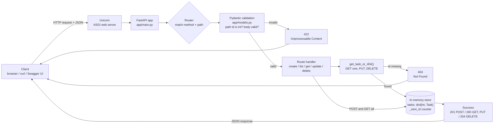
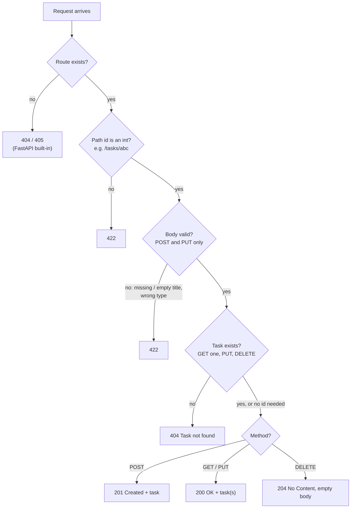
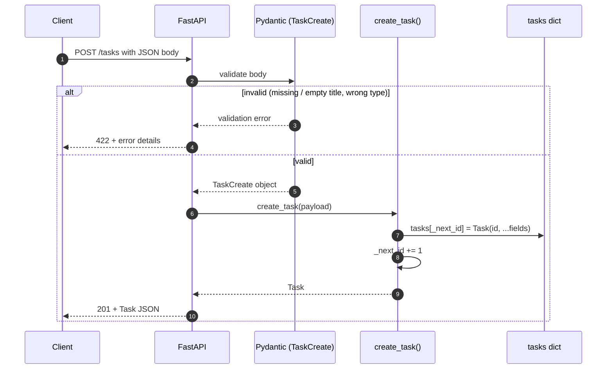
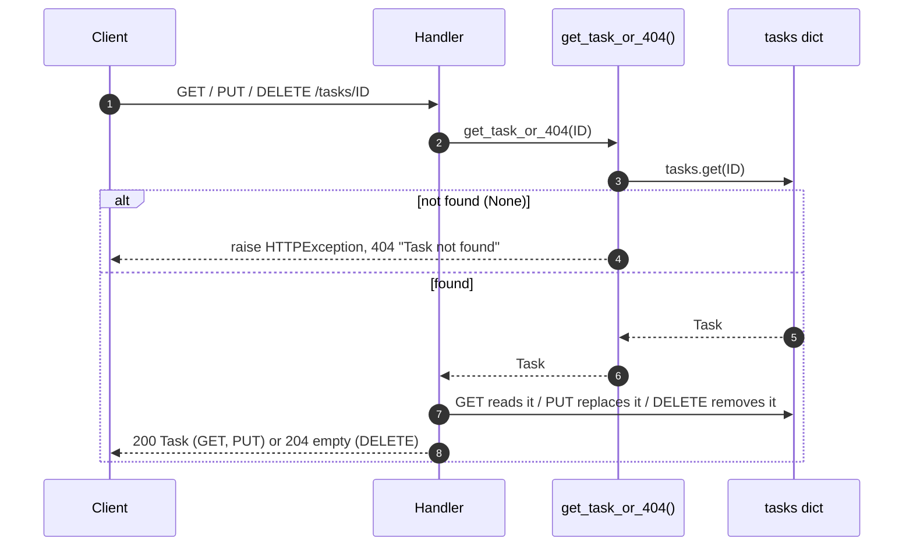
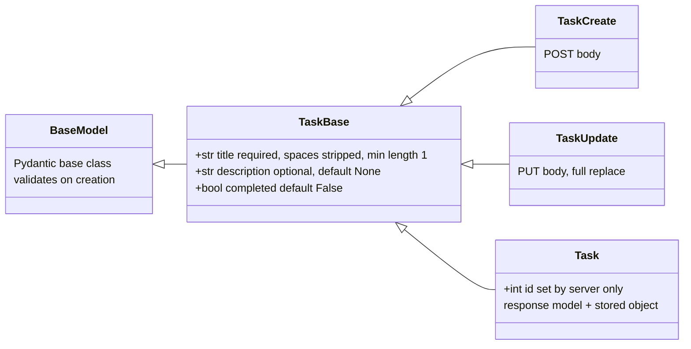
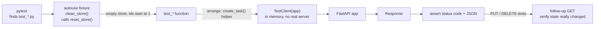
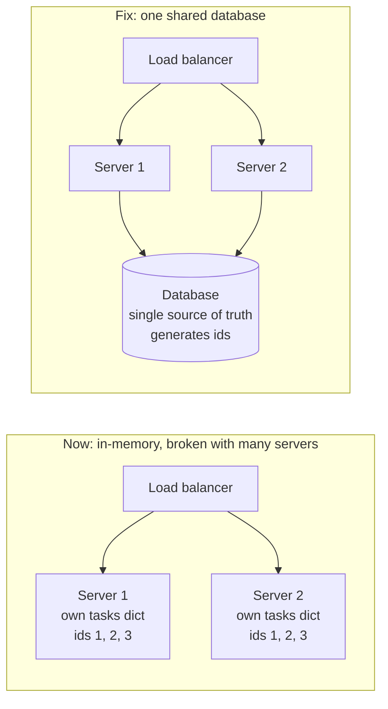

# Task API (FastAPI practice)

A small REST API for managing tasks, built with **FastAPI** and **Pydantic**, with **pytest** tests.
Tasks are stored in memory, so they disappear when the server restarts.

## Project structure

```
01-rest-api-basics/
├── requirements.txt       # pinned dependencies
├── app/
│   ├── models.py          # Pydantic models (validation)
│   └── main.py            # FastAPI app, in-memory store, endpoints
├── tests/
│   └── test_tasks.py      # pytest tests for every endpoint
└── INTERVIEW_QA.md        # interview questions and answers about this project
```

## Setup (Windows, PowerShell)

```powershell
python -m venv .venv            # only if .venv doesn't exist yet
.\.venv\Scripts\Activate.ps1
pip install -r requirements.txt
```

## Run the server

```powershell
uvicorn app.main:app --reload
```

Then open http://127.0.0.1:8000/docs for interactive Swagger UI, where you can try every endpoint.

## Run the tests

```powershell
python -m pytest -v
```

## Task fields

| Field | Type | Required | Default |
|---|---|---|---|
| `id` | int | set by the server | auto-increment |
| `title` | string | yes (can't be empty or only spaces) | - |
| `description` | string or null | no | `null` |
| `completed` | bool | no | `false` |

## Endpoints

| Method | Path | Success | Errors |
|---|---|---|---|
| POST | `/tasks` | 201 Created | 422 invalid body |
| GET | `/tasks` | 200 OK | - |
| GET | `/tasks/{id}` | 200 OK | 404 not found, 422 non-integer id |
| PUT | `/tasks/{id}` | 200 OK | 404 not found, 422 invalid body |
| DELETE | `/tasks/{id}` | 204 No Content | 404 not found |

PUT is a **full replacement**: any field you leave out goes back to its default.

## Diagrams (quick revision)

### 1. Big picture: how a request flows



### 2. Which status code will I get?



> Validation runs **before** the handler, so `PUT /tasks/999` with an empty title returns **422**, not 404.

### 3. POST /tasks step by step



### 4. GET one / PUT / DELETE: the shared 404 check



### 5. Pydantic models



> Clients send `TaskCreate`/`TaskUpdate` (no `id`). The server stores and returns `Task` (with `id`).

### 6. How the tests run



### 7. Why in-memory storage doesn't scale (and the fix)



> Created on Server 1, then read from Server 2, gives a 404. Ids also clash, because each server counts from 1.

### Example

```powershell
curl.exe -X POST http://127.0.0.1:8000/tasks -H "Content-Type: application/json" -d '{\"title\": \"Buy milk\"}'
```
Response (201):
```json
{"title": "Buy milk", "description": null, "completed": false, "id": 1}
```

## Design notes

- **In-memory dict** (`id -> Task`) for O(1) lookup by id. An id counter means ids are never reused after a delete.
- **`get_task_or_404` helper** keeps the 404 logic in one place.
- **Separate request and response models** (`TaskCreate`/`TaskUpdate` vs `Task`), so clients can't set the `id`.
- **Tests are isolated:** an `autouse` fixture resets the store before every test.

## Limitations (fine for practice)

- Data is lost on restart, and isn't shared across multiple server processes.
- No locking, so it isn't safe under heavy concurrent writes.
- No PATCH (partial update), pagination, or authentication.
