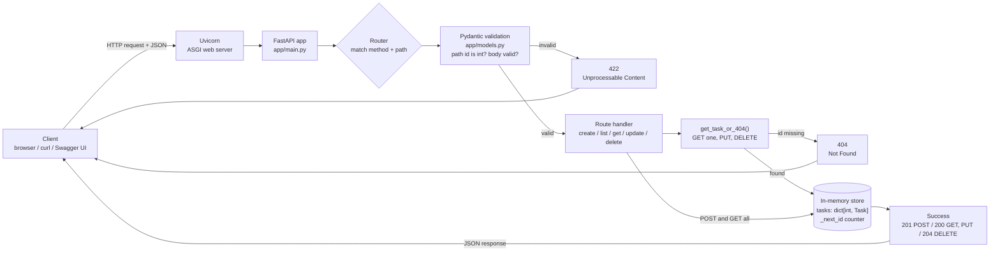
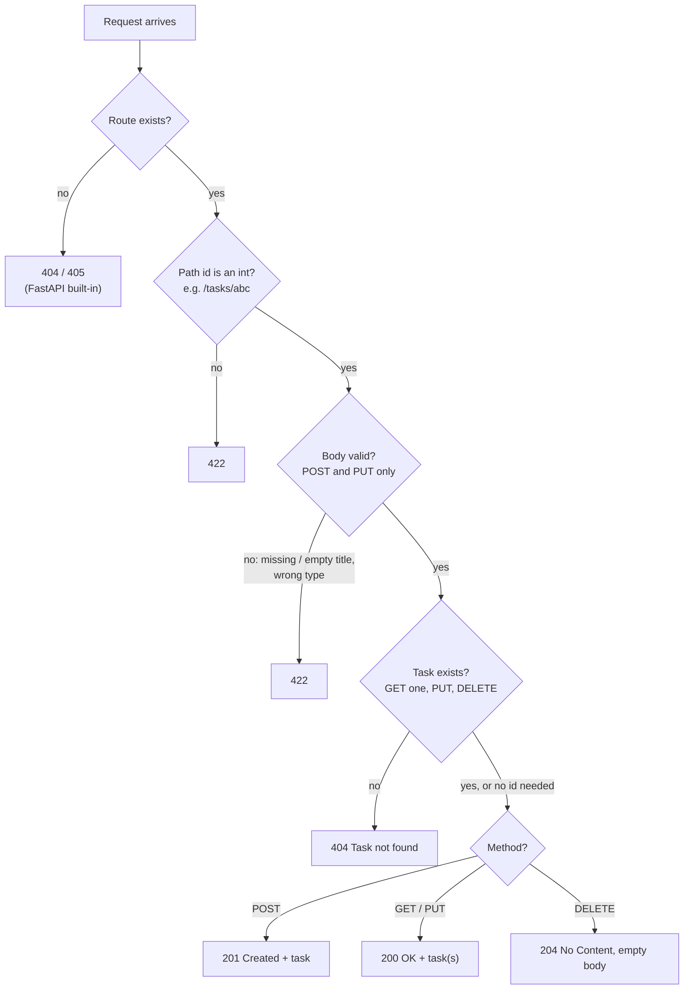
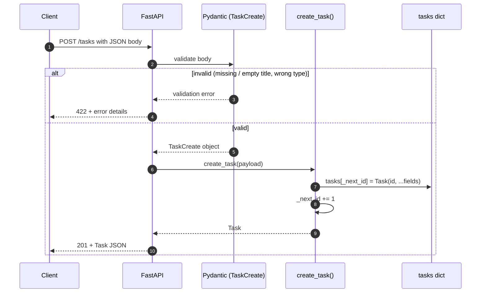
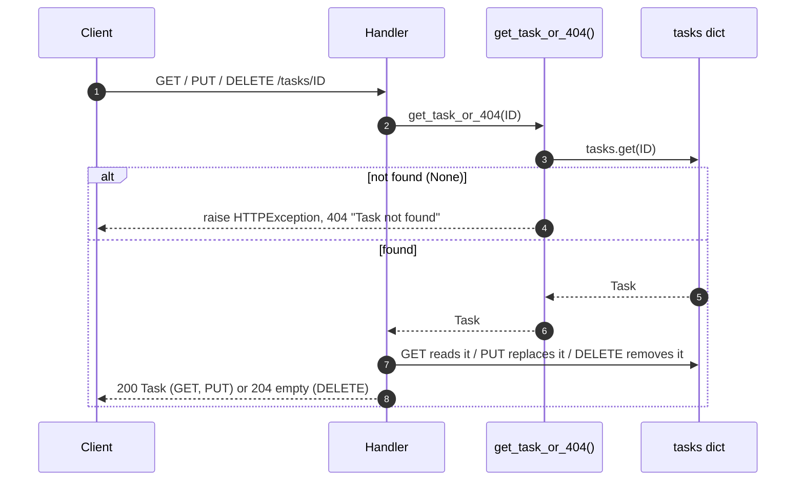
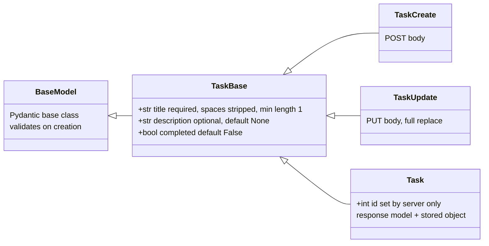
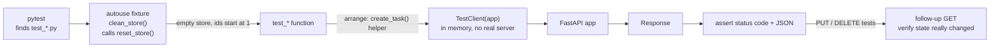
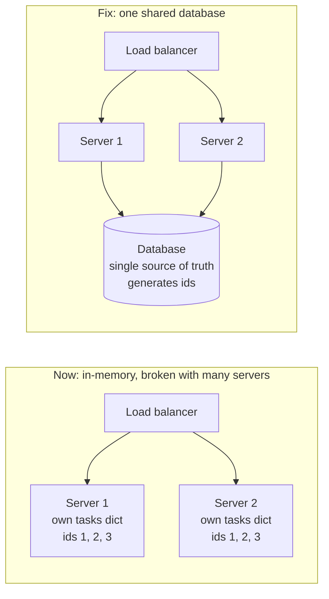

# Task API (FastAPI practice)

A small REST API for managing tasks, built with **FastAPI** and **Pydantic**, with **pytest** tests.
Tasks are stored in memory, so they disappear when the server restarts.

## Project structure

```
01-rest-api-basics/
├── requirements.txt       # pinned dependencies
├── app/
│   ├── models.py          # Pydantic models (validation)
│   └── main.py            # FastAPI app, in-memory store, endpoints
├── tests/
│   └── test_tasks.py      # pytest tests for every endpoint
└── INTERVIEW_QA.md        # interview questions and answers about this project
```

## Setup (Windows, PowerShell)

```powershell
python -m venv .venv            # only if .venv doesn't exist yet
.\.venv\Scripts\Activate.ps1
pip install -r requirements.txt
```

## Run the server

```powershell
uvicorn app.main:app --reload
```

Then open http://127.0.0.1:8000/docs for interactive Swagger UI, where you can try every endpoint.

## Run the tests

```powershell
python -m pytest -v
```

## Task fields

| Field | Type | Required | Default |
|---|---|---|---|
| `id` | int | set by the server | auto-increment |
| `title` | string | yes (can't be empty or only spaces) | - |
| `description` | string or null | no | `null` |
| `completed` | bool | no | `false` |

## Endpoints

| Method | Path | Success | Errors |
|---|---|---|---|
| POST | `/tasks` | 201 Created | 422 invalid body |
| GET | `/tasks` | 200 OK | - |
| GET | `/tasks/{id}` | 200 OK | 404 not found, 422 non-integer id |
| PUT | `/tasks/{id}` | 200 OK | 404 not found, 422 invalid body |
| DELETE | `/tasks/{id}` | 204 No Content | 404 not found |

PUT is a **full replacement**: any field you leave out goes back to its default.

## Diagrams (quick revision)

### 1. Big picture: how a request flows



**In plain words: sending a note to a library**
- **You (the client)** write a note: "Please add a chore: Buy milk."
- **Uvicorn** is the front-door guard. It accepts every note that arrives.
- **FastAPI and the router** are the receptionist. They read the note's label (`POST /tasks`) and send it to the right desk.
- **Pydantic** is the spelling teacher. It checks the note is filled in correctly: is the title there, and not blank? If not: ❌ **422**, "Your note is filled in wrong."
- **The handler** is the librarian who does the actual job.
- **The storage box** (the in-memory dict) is where the chores are kept. Ask for a chore that isn't there: ❌ **404**, "We don't have that one."

### 2. Which status code will I get?



> Validation runs **before** the handler, so `PUT /tasks/999` with an empty title returns **422**, not 404.

**In plain words: a game of yes or no, asked in order**
1. Does this desk exist (is the route real)? No → **404**
2. Is the chore number really a number (`/tasks/abc`)? No → **422**
3. Is the note filled in correctly (create and update only)? No → **422**
4. Does the chore exist? No → **404**
5. Everything's fine:
   - Created something → **201**, "Made it!"
   - Read or updated → **200**, "Here you go!"
   - Deleted → **204**, "Done, nothing to show."

Remember: checks go **from the outside in**. Envelope first, then the letter, then the shelf.

### 3. POST /tasks step by step



**In plain words: a ticket number at a bakery**
```
You: "Add 'Buy milk'"
  → Spelling teacher checks it ✅
  → Librarian gives it the next number on the counter (numbers are never reused)
  → Puts it in the box
  → Replies: 201, here's your chore with id 1
```
The bakery gives you the number. You don't choose it.

### 4. GET one / PUT / DELETE: the shared 404 check



**In plain words: check the class register first**
All three start the same way: "Find chore #5 first." That's the shared helper, `get_task_or_404`.
- **Not found** → **404**, and the story stops.
- **Found:**
  - **GET**: "Here's chore #5." (200)
  - **PUT**: "I've replaced chore #5 with your new version." (200)
  - **DELETE**: "Chore #5 is gone." (204)

It's like a teacher checking that a student is in the class register before doing anything with their homework.

### 5. Pydantic models



> Clients send `TaskCreate`/`TaskUpdate` (no `id`). The server stores and returns `Task` (with `id`).

**In plain words: a family of forms**
```
        TaskBase (title, description, completed)
       /         |           \
TaskCreate   TaskUpdate      Task (+ id)
```
- **TaskBase** is the parent form. It has the common boxes.
- **TaskCreate** is the form you fill in to make a chore.
- **TaskUpdate** is the form you fill in to change a chore.
- **Task** is the receipt the library gives back. Only it has the **id** box, so you can't write your own chore number.

### 6. How the tests run



**In plain words: wipe the whiteboard before each turn**
1. Wipe the board clean (the autouse fixture runs `reset_store`).
2. Pretend to be a user (`TestClient` sends fake requests).
3. Check the answers with `assert`: right status code? right data?
4. For PUT and DELETE, check again afterwards with a GET, to make sure the change really happened.

It's like a teacher who erases the whiteboard before each student's turn, so nobody copies the last student's answer.

### 7. Why in-memory storage doesn't scale (and the fix)



> Created on Server 1, then read from Server 2, gives a 404. Ids also clash, because each server counts from 1.

**In plain words: three librarians, three notebooks**
```
         Load balancer
        /      |      \
  Server 1  Server 2  Server 3
  📓 own     📓 own    📓 own
  notebook  notebook  notebook
```
1. You give the chore "Buy milk" to Librarian 1.
2. Next time you happen to ask Librarian 2: "Where's my chore?" Librarian 2 says: "Never heard of it!" (**404**)
3. Worse, each librarian counts from 1, so two different chores can both be #1.

**The fix:** one shared notebook that all the librarians use. That's a database.
```
  Server 1 ─┐
  Server 2 ─┼──► 🗄️ One shared database
  Server 3 ─┘
```

### Super-short version to remember

| Topic | One line |
|---|---|
| Request flow | guard → receptionist → spelling teacher → librarian → box |
| Status codes | check from the outside in; **404** = missing, **422** = wrong input |
| POST | the library gives you a ticket number (**201**) |
| GET / PUT / DELETE | first check it exists, then act |
| Models | a parent form and its children; only the receipt has the id |
| Tests | wipe the board before each turn |
| Scaling | three notebooks break things; one shared database fixes it |

### Example

```powershell
curl.exe -X POST http://127.0.0.1:8000/tasks -H "Content-Type: application/json" -d '{\"title\": \"Buy milk\"}'
```
Response (201):
```json
{"title": "Buy milk", "description": null, "completed": false, "id": 1}
```

## Design notes

- **In-memory dict** (`id -> Task`) for O(1) lookup by id. An id counter means ids are never reused after a delete.
- **`get_task_or_404` helper** keeps the 404 logic in one place.
- **Separate request and response models** (`TaskCreate`/`TaskUpdate` vs `Task`), so clients can't set the `id`.
- **Tests are isolated:** an `autouse` fixture resets the store before every test.

## Limitations (fine for practice)

- Data is lost on restart, and isn't shared across multiple server processes.
- No locking, so it isn't safe under heavy concurrent writes.
- No PATCH (partial update), pagination, or authentication.
